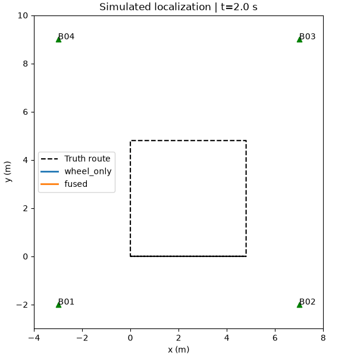
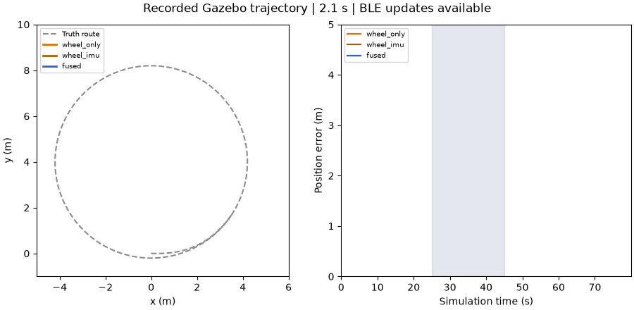
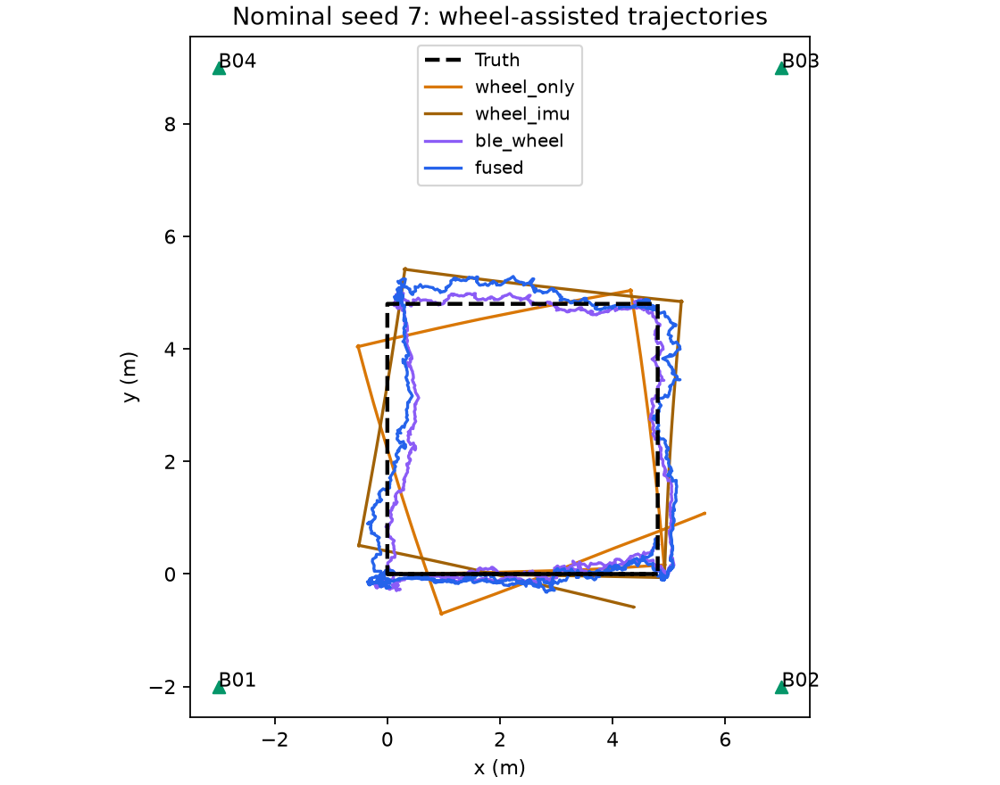
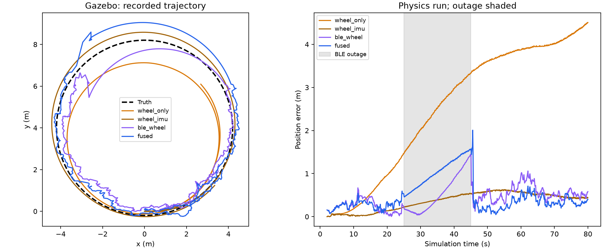
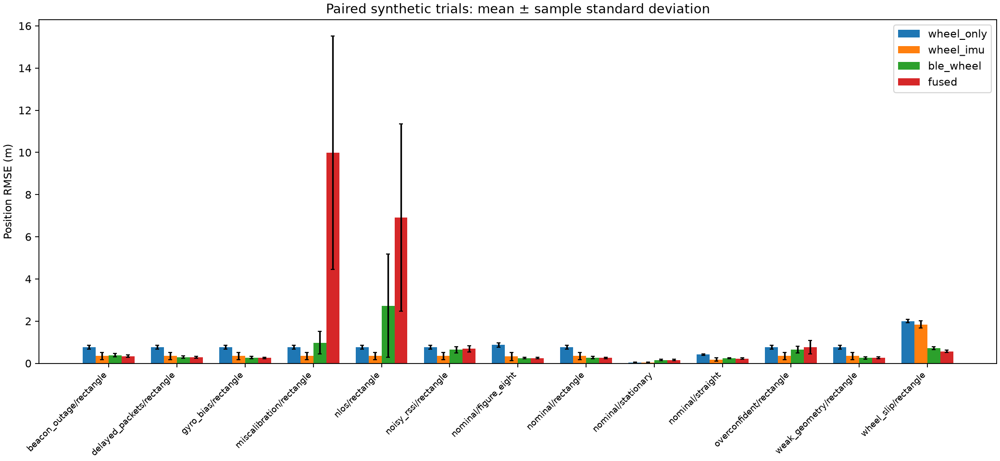
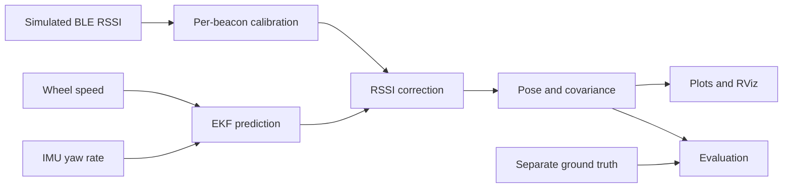

<div align="center">

# BLE + IMU EKF Localization

**Simulated indoor positioning with BLE RSSI, inertial sensing, and wheel odometry.**


[Quick start](#quick-start) · [Gazebo demo](#gazebo-demo) · [Results](#results) · [How it works](docs/LOCALIZATION_MODEL.md)



*Recorded synthetic trajectory, seed 7. Blue follows the fused estimate; wheel-only odometry accumulates drift.*

</div>

An explicit Extended Kalman Filter estimates a differential-drive robot's position, heading, and gyro bias in a surveyed BLE beacon map. Run lightweight Python experiments, replay the same sensor log, or watch the robot in Gazebo and RViz.

This is a **simulation project**. BLE observations are generated RSSI values, not transmitted Bluetooth packets. Beacon coordinates are known; the estimator performs localization rather than map discovery.

## Features

- Four-state EKF: `[x, y, yaw, gyro_bias]`.
- Wheel-speed and gyroscope prediction with analytic Jacobians.
- Direct RSSI correction, per-beacon calibration, NIS gating, and Joseph covariance updates.
- Six baselines, ten sensor scenarios, and four routes.
- Deterministic sensor logs, causal replay, and position/covariance diagnostics.
- Gazebo native IMU, encoder odometry, synthetic radio observations, and RViz visualization.

## Quick start

Python 3.10+ is sufficient for the standalone simulator. ROS and Gazebo are optional.

### 1. Clone and install

```bash
git clone https://github.com/rivindu02/ble-imu-ekf-localization.git
cd ble-imu-ekf-localization
python3 -m venv .venv
source .venv/bin/activate
python -m pip install -r requirements.txt
```

### 2. Run the tests

```bash
python -m unittest discover -s tests -v
```

Nine focused tests cover numerical Jacobians, calibration, covariance, rejection, clocks, reproducibility, replay, and sensor outages.

### 3. Run a trajectory

```bash
python scripts/localization.py run
```

This fits the radio calibration from independent simulated stationary samples, then runs the rectangular route with seed 7. Outputs appear in `results/localization/nominal_rectangle_7/`:

| File | Contents |
|---|---|
| `trajectory.png` | Estimated paths and position errors |
| `metrics.json` | Error, availability, uncertainty and sensor diagnostics |
| `events.jsonl` | Timestamped encoder, IMU and BLE events |
| `recording.npz` | Ground truth, estimates and covariance |
| `manifest.json` | Scenario, seed, configuration and provenance |
| `innovations.json` | Accepted/rejected RSSI corrections and NIS |

### 4. Replay the same measurements

```bash
python scripts/localization.py replay \
  --run-dir results/localization/nominal_rectangle_7
```

Replay verifies that all six estimates and the covariance match the saved recording. It uses recorded measurements, not a fresh noise realization.

### 5. Try a sensor outage or another route

```bash
python scripts/localization.py run --scenario beacon_outage
python scripts/localization.py run --route figure_eight --seed 12
python scripts/localization.py --help
```

Routes: `stationary`, `straight`, `rectangle`, `figure_eight`.

Scenarios: `nominal`, `noisy_rssi`, `nlos`, `beacon_outage`, `weak_geometry`, `gyro_bias`, `wheel_slip`, `miscalibration`, `delayed_packets`, `overconfident`.

### 6. Reproduce the benchmark and README media

```bash
python scripts/localization.py batch --trials 20 --all-routes
python scripts/validate_experiments.py
python scripts/render_media.py
```

The benchmark runs **260 trials**: 20 paired seeds for ten rectangular-route scenarios, plus nominal runs on the other three routes. It takes several minutes. README images and GIFs are rebuilt from saved recordings; the Gazebo animation also needs the included `gazebo_outage` recording or a completed local Gazebo run.

## Gazebo demo

Tested with **Ubuntu 22.04, ROS 2 Humble, Gazebo Classic 11.10.2, Python 3.10, and NumPy**. Use an existing compatible environment; on this machine it is the Ubuntu Distrobox named `devbox`.

### 1. Enter the ROS environment

```bash
distrobox enter devbox
cd /path/to/ble-imu-ekf-localization
```

The launcher sources ROS automatically. Run it with the container's Python; deactivate an unrelated host virtual environment first.

### 2. Check a short headless run

```bash
bash gazebo/run_localization.sh headless 15
```

Headless mode opens no window. Progress prints every five seconds with simulated time and sensor counts. Wait for **`Saved and validated`**.

### 3. Open Gazebo and RViz with a BLE outage

```bash
bash gazebo/run_localization.sh gui 80 beacon_outage
```

The radio stops between **25 and 45 simulated seconds**. The demo stops automatically after 80 simulated seconds.

- **Black:** ground-truth path.
- **Blue:** fused estimate and 95% position-uncertainty ellipse.
- **Orange:** wheel-only dead reckoning.
- **Green markers:** surveyed beacon positions.

The controller uses simulator truth to follow a repeatable route. The localization node receives only sensor events, the known beacon map, and its declared initial conditions.



*Animation reconstructed from the validated Gazebo recording, not a screen capture. The shaded interval is the radio outage.*

### 4. Validate saved output

Every launch prints its output folder. Use that folder to rerun the checks:

```bash
python3 scripts/validate_localization_run.py results/localization/gazebo_YYYYMMDD_HHMMSS
```

[Gazebo setup, topics and troubleshooting →](docs/LOCALIZATION_GAZEBO.md)

## Results

### Paired Python simulations

Mean position RMSE across 20 nominal rectangular-route seeds; ± is the sample standard deviation.

| Method | Position RMSE |
|---|---:|
| Wheel-only dead reckoning | 0.771 ± 0.088 m |
| Wheel + IMU dead reckoning | 0.345 ± 0.171 m |
| BLE-only fixes | 2.020 ± 0.096 m |
| BLE + wheel EKF | 0.272 ± 0.050 m |
| **BLE + wheel + IMU EKF** | **0.257 ± 0.040 m** |
| IMU-only integration diagnostic | 2.004 ± 0.836 m |



### Gazebo outage trial

One completed 80.08-second physics run recorded 4,003 IMU messages, 800 encoder messages, and a 20.10-second radio gap.

| Method | Position RMSE |
|---|---:|
| Wheel-only dead reckoning | 2.974 m |
| Wheel + IMU dead reckoning | **0.416 m** |
| BLE + wheel EKF | 0.544 m |
| Full fusion | 0.657 m |

Fusion improved on wheel-only in this run; wheel + IMU dead reckoning performed best. These physics results are separate from the paired kinematic benchmark.



### Failure cases matter

RSSI bias can overwhelm the calibrated observation model. NLOS and miscalibration scenarios retain those failures in the results rather than assuming fusion always wins. All accuracy values are synthetic and do not predict physical BLE accuracy.



[Benchmark summary](results/localization/summary.json) · [Per-trial metrics](results/localization/metrics.csv) · [Model and assumptions](docs/LOCALIZATION_MODEL.md) · [Experiment details](docs/EXPERIMENTS.md)

## How it works



The motion model integrates encoder speed and bias-corrected gyro rate. The observation model predicts RSSI from 3D beacon-to-receiver distance. Measurements update the filter in timestamp order; late data is rejected and counted, stale motion inputs expire, and uncertainty is propagated explicitly.

[State equations, Jacobians, noise units and covariance updates →](docs/LOCALIZATION_MODEL.md)

## Project layout

```text
config/                 Robot, beacons, sensors and filter settings
src/localization/       Models, EKF, simulation, calibration and replay
tests/                  Focused numerical and replay tests
gazebo/                 Robot template, generated world, ROS nodes and RViz
scripts/                Experiment, validation and media commands
docs/                   Technical guides and README media
results/localization/   Benchmark metrics and selected recordings
```

Edit `config/localization.json` to change the beacon layout or sensor/filter parameters. After changing world or IMU settings, rebuild the world:

```bash
python scripts/build_localization_world.py
```

Generated local logs, virtual environments, and transient Gazebo runs are ignored by Git. The original EKF-SLAM project is maintained separately at [rivindu02/ekf-slam-simulation](https://github.com/rivindu02/ekf-slam-simulation).
